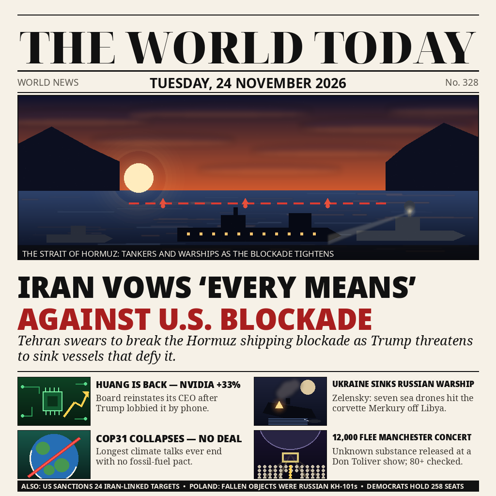

# THE WORLD TODAY — Tuesday, 24 November 2026

[](https://make.fun/c/news-image-20261124)

A one-page newspaper front page that sums up the world's news of
**Tuesday, 24 November 2026** in a single image — built for the
[news-image-20261124 bounty on make.fun](https://make.fun/c/news-image-20261124).
Top 50 entries share $100 (1st $20, 2nd $12, 3rd $6, 4th–10th $2,
11th–50th $1.20).



## The five stories in the image

1. **LEAD — Iran vows "every means" against the U.S. blockade.**
   Iran swore to use every means to break the U.S. naval blockade of
   its ports at the Strait of Hormuz, after President Trump threatened
   to sink ships that defy it. The vow came on Sunday, 22 November.
   Source: Reuters, 23 Nov 2026.
2. **Huang is back — Nvidia +33%.** Nvidia's board unanimously
   reinstated co-founder Jensen Huang as CEO on Monday, 23 November,
   after President Trump lobbied the board by phone; shares soared 33%
   at the open. Source: Reuters, 23 Nov 2026.
3. **Ukraine sinks Russian warship.** President Zelensky confirmed
   Ukraine sank the Russian Navy corvette *Merkury* off Libya with
   seven sea drones; the cargo ship MV Angara was also hit and a Ka-27
   helicopter destroyed. Sources: Associated Press and Reuters,
   23 Nov 2026.
4. **COP31 collapses — no deal.** UN climate talks in Antalya ended on
   Sunday, 22 November, without an overarching agreement — the longest
   COP on record and the first no-deal COP since 2009 — after the final
   draft made no mention of fossil fuels. Sources: Reuters and BBC,
   22 Nov 2026.
5. **12,000 flee Manchester concert.** More than 12,000 fans were
   evacuated from a Don Toliver concert at Manchester's Co-op Live
   arena on Sunday night, 22 November, after an unknown substance was
   released in the crowd; over 80 people were checked by medics and
   one was taken to hospital. Sources: Reuters and BBC, 23 Nov 2026.

Also in the footer ticker: the U.S. sanctions 24 Iran-linked targets;
Poland confirms the objects that fell on its villages were Russian
Kh-101 cruise missiles; Democrats hold their 258-seat House majority.

## How the image is made

`compose.py` draws the whole front page with PIL — real fonts, so every
word is spelled exactly as written: a layered dusk scene over the Strait
of Hormuz (sky gradient, low sun, rocky headlands, a tanker hemmed in by
warships, the dashed red blockade line with warning buoys), the masthead
and dateline, the lead headline, four secondary stories with small
hand-drawn scenes, and a footer ticker. No AI image generator is used
for any part that contains words.

`main.ts` is the competition entrypoint (Node 22, standard library only).
It validates `entry.png` — PNG magic bytes, IHDR dimensions, IEND chunk,
the 1024×1024 and 1 MiB caps — then copies it to
`$MAKEFUN_OUTPUT_DIR/entry.png` and reads the copy back to prove it
matches byte for byte.

## Run it

```sh
mkdir -p out && MAKEFUN_OUTPUT_DIR=out node main.ts
```

To re-render the image from scratch:

```sh
python3 compose.py   # writes entry.png (1024x1024, under 1 MiB)
```

## License

MIT — see [LICENSE](LICENSE).
